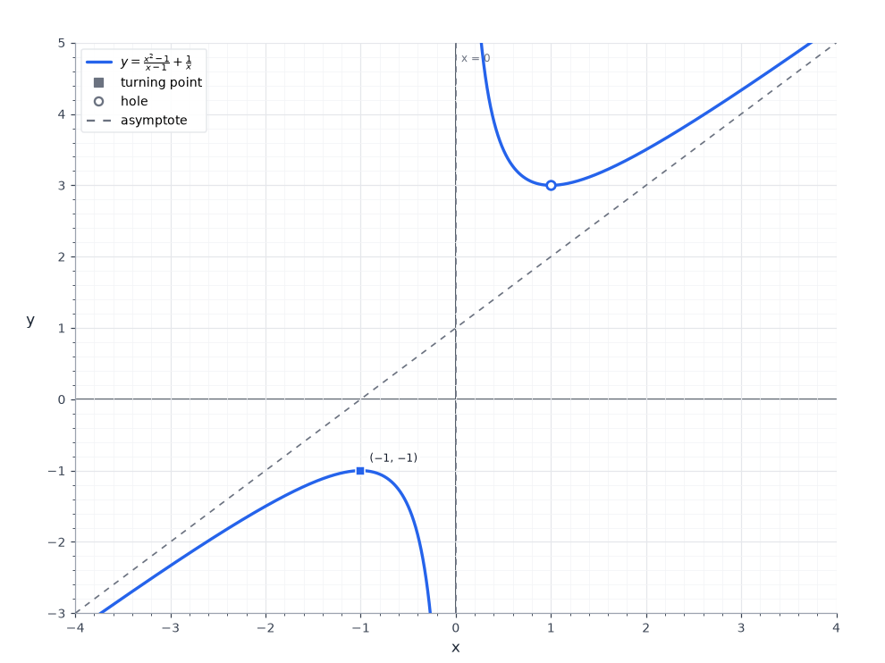
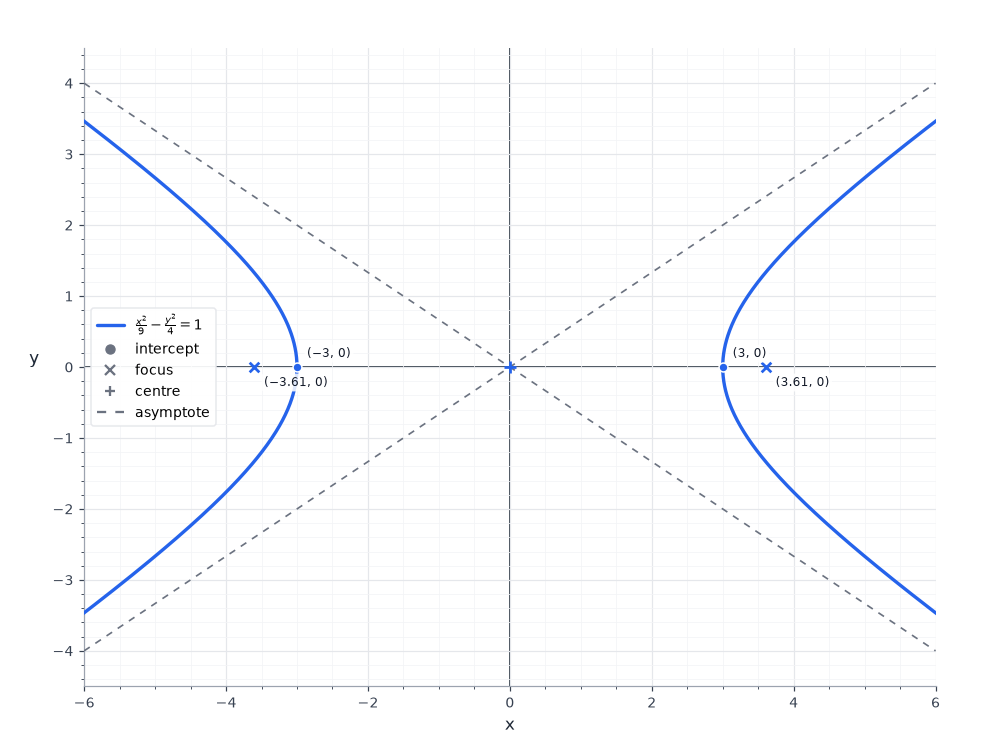
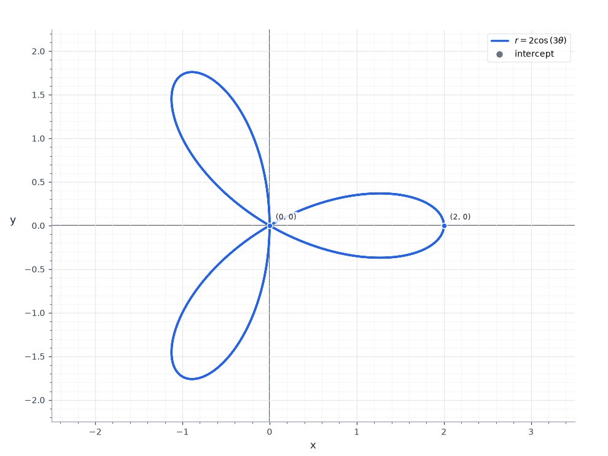

# Equation Plotter MCP

<!-- mcp-name: io.github.tallaprs15/equation-plotter-mcp -->

[](https://github.com/tallaprs15/equation-plotter-mcp/actions/workflows/ci.yml)
[](https://pypi.org/project/equation-plotter-mcp/)
[](LICENSE)

**Give your AI assistant a graphing calculator that shows its working, with exact answers.**

An MCP server (plus a CLI and a Python library) that takes equations and returns one JSON
document describing each graph, together with the rendered image:

* **Exact values.** Intercepts, turning points, asymptotes, holes, domain and range, symmetry,
  period and so on are given exactly (`"sqrt(2)/2"`, `"pi/3"`) and as floats.
* **Honest about method.** Every field says whether it was solved symbolically or estimated
  numerically, so a model never presents a guess as a fact.
* **Many kinds of input.** Explicit (`y = …`), implicit (`x^2 + y^2 = 25`), parametric, polar
  and inequalities (shaded regions), several equations on one set of axes (with intersections),
  friendly syntax (`3x`, `sin^2 x`, `|x|`, `π`) and a LaTeX subset.
* **Curve identification.** Lines, quadratics, circles, ellipses, hyperbolas (foci, vertices,
  eccentricity, asymptotes), cardioids, limaçons, roses, lemniscates and spirals.
* **Safe for hostile input.** Its own parser never `eval`s anything. Every job runs in an
  isolated, time- and memory-limited worker process, and errors come back as JSON.

| | | |
|---|---|---|
|  |  |  |

Ask your assistant things like *"Plot y = (x²−1)/(x−1) and explain the hole"* or *"Where do
x²/9 − y²/4 = 1 and y = x/2 meet?"*.

## Quick start

### Use the hosted server (nothing to install)

Add this URL as a remote MCP server (no sign-in):

```
https://equation-plotter-mcp-581039101175.australia-southeast1.run.app/mcp
```

* **Claude.ai / Claude Desktop:** Settings → Connectors → *Add custom connector* → paste the URL.
* **Claude Code:** `claude mcp add --transport http equation-plotter https://equation-plotter-mcp-581039101175.australia-southeast1.run.app/mcp`
* **Cursor / VS Code / others:** add a remote (Streamable HTTP) server with that URL.

The hosted server is free and rate-limited per caller, with no uptime guarantee. For heavy or
private use, run it yourself.

### Run it locally (stdio)

With [uv](https://docs.astral.sh/uv/) installed:

```bash
# Claude Code
claude mcp add equation-plotter -- uvx equation-plotter-mcp
```

```json
// Claude Desktop: claude_desktop_config.json
{ "mcpServers": { "equation-plotter": { "command": "uvx", "args": ["equation-plotter-mcp"] } } }
```

Or `pip install equation-plotter-mcp` and use the `equation-plotter-mcp` command. Requires
Python ≥ 3.10.

### CLI and Python library

```console
$ equation-plotter "y = x^2 - 3x + 2"
{ "version": "1.0", "equations": [ { "classification": "quadratic",
  "x_intercepts": [ {"x": {"exact": "1", "float": 1.0}, ...}, ... ],
  "stationary_points": [ {"x": {"exact": "3/2", "float": 1.5},
                          "y": {"exact": "-1/4", "float": -0.25}, "nature": "local minimum"} ],
  ... } ], "viewport": {...}, "warnings": [], "image": {"format": "png", "data": "iVBOR..."} }
```

```python
from equation_plotter import analyse_and_plot
result = analyse_and_plot(["y = sin(x)", "y = cos(x)"], x_range=None, y_range=None,
                          image_format="png")
```

`examples/` holds 16 representative runs (JSON + PNG). In the JSON there, the base64 data is
truncated; the PNG next to it is that image.

---

## CLI

```
equation-plotter EQUATION [EQUATION ...] [options]

  --x-range A,B        x window (use --x-range=-5,5 or --x-range "[-5,5]" for negatives)
  --y-range A,B        y window
  --t-range A,B        parameter range for parametric curves (default: one period, else [-5, 5])
  --theta-range A,B    theta range for polar curves (default: full period, else [0, 4π])
  --format png|svg|none   embedded image format (default png; inferred from --save-image)
  --out FILE           write JSON to FILE instead of stdout
  --save-image FILE    also write the decoded image to FILE
  --no-image-data      drop the base64 payload from the JSON (handy with --save-image)
  --timeout SECONDS    symbolic analysis budget (default 20, max 120)
  --compact            single-line JSON
```

Range values may be expressions: `--x-range "[-2pi, 2pi]"`.
Exit code: `0` on success, `2` when the JSON is an error document.

```bash
equation-plotter "x^2 + y^2 = 25" --format svg --out result.json
equation-plotter "y = sin(x)" "y = cos(x)" --save-image graph.png
equation-plotter "x = cos(3t), y = sin(2t)" --t-range "[0, 2pi]"
equation-plotter "r = 2cos(3theta)" --save-image rose.png --no-image-data
equation-plotter "y > x^2 - 4" "x^2 + y^2 <= 9"
```

## Input syntax

| Kind | Examples |
|---|---|
| Explicit | `y = x^2 - 3x + 2`, `f(x) = 1/(x-2)` (also `g`, `h`), bare `x^3 - x` |
| Implicit | `x^2 + y^2 = 25`, `x^2/9 - y^2/4 = 1`, `xy = 1`, `sin(x) = cos(y)` |
| Parametric | `x = cos(t), y = sin(t)` or `(cos t, sin t)` |
| Polar | `r = 1 + cos(theta)`, `r = 2cos(3θ)`, `r^2 = 4cos(2theta)` |
| Inequality | `y > x^2`, `x^2 + y^2 <= 9` (`<`, `>`, `<=`, `>=`, `≤`, `≥`) |
| LaTeX | `y = \frac{1}{x-2}`, `\sqrt{x}`, `\sqrt[3]{x}`, `\sin`, `\pi`, `\cdot`, `\left( \right)`, `\le` |

Friendly syntax: `^` or `**` for powers; implicit multiplication (`3x`, `2sin(x)`, `xy`,
`(x+1)(x-1)`, `2pi`); `sin x` without parentheses; `sin^2 x` = `(sin x)^2`; `sin^-1 x` = `asin x`;
`|x|` for absolute value; Unicode `π θ √ ² ³ × · − ≤ ≥`; names are case-insensitive.

Constants are `pi`, `e`. Functions are `sin cos tan sec csc/cosec cot`, `asin acos atan`
(also `arcsin`…), the hyperbolics and their inverses, `exp`, `ln`, `log` (base 10), `log(x, b)`,
`log2`, `log10`, `sqrt`, `cbrt` (real cube root), `abs`, `sign/sgn`, `floor`, `ceil`.
Decimals are read exactly (`0.5` → `1/2`).

## Output JSON (schema version `1.0`)

Top level:

| Key | Meaning |
|---|---|
| `version` | Schema version (`"1.0"`). Bumped on any incompatible change. |
| `plotter_version` | Package version. |
| `equations` | One object per input, in order (see below). |
| `intersections` | `[{equations: [i, j], points: [point…], method}]` for pairs of explicit / implicit / inequality-boundary curves. |
| `viewport` | `{x: [xmin, xmax], y: [ymin, ymax], aspect: "auto"\|"equal", auto: bool}`, the window actually drawn. |
| `warnings` | `[{equation: i\|null, field, code, message}]`. Codes include `timeout`, `symbolic_failed`, `budget_exhausted`, `hard_timeout`, `render_timeout`, `truncated`. |
| `timing_ms` | `{analysis, render, total}` |
| `image` | `{format, mime_type, width, height, units ("px" for PNG, "pt" for SVG), encoding: "base64", data}`, or `null` for `image_format="none"` / render timeout. |

Errors replace everything except the versions:
`{"version": "1.0", "plotter_version": "...", "error": {"code", "message", "equation"?, "position"?}}`.
Error codes: `invalid_input`, `empty_input`, `input_too_long`, `invalid_character`,
`unknown_name`, `syntax_error`, `number_too_large`, `too_complex`, `undefined_value`,
`unsupported_variable`, `no_variables`, `degenerate_equation`, `latex_error`, `invalid_range`,
`invalid_format`, `invalid_timeout`, `too_many_equations`, `internal_error`.

**Numbers.** Every number is `{"exact": "<SymPy string>" | null, "float": <number> | null}`,
for example `{"exact": "sqrt(2)/2", "float": 0.707106781187}`. Infinity is `{"exact": "oo", "float": null}`.
`exact` is `null` for a numeric estimate. A **point** is `{"x": number, "y": number, ...extra}`.
Extra keys include `nature`, `t` and `theta`.

**Sets** (`domain`, `range`, `r_range`) are `{method, exact, text, intervals?}`. `intervals` is a list
of `{lower, upper, left_open, right_open, text}`, `text` is readable (`"(-∞, 2) ∪ (2, ∞)"`), and
`exact` is the SymPy set. Numeric estimates have `method: "numeric_estimate"`, `exact: null`, a
`≈` in `text`, and a `note` that says what was sampled.

**`methods`.** Each equation carries a `methods` map from field to how it was obtained:

* `exact` means symbolic and complete.
* `exact_in_viewport` means exact values, listed only inside the viewport, because there are
  infinitely many (the general solution is in `general_solutions`).
* `numeric_in_viewport` / `numeric_estimate` mean numeric fallback.
* `unavailable` means the field could not be computed.

Per-equation fields (present where they apply):

| Field | explicit | implicit | parametric | polar |
|---|:-:|:-:|:-:|:-:|
| `index`, `input`, `type`, `normalised`, `latex`, `classification`, `families`, `methods` | ✓ | ✓ | ✓ | ✓ |
| `domain`, `range` (x-extent / y-extent for curves) | ✓ | ✓ | ✓ | ✓ (numeric) |
| `x_intercepts` | ✓ | ✓ | ✓ | ✓ |
| `y_intercept` (single point or null) | ✓ | | | |
| `y_intercepts` | | ✓ | ✓ | ✓ |
| `stationary_points` (`nature`: local max/min, stationary inflection; implicit: horizontal tangents) | ✓ | ✓ | ✓ | |
| `points_of_inflection` | ✓ | | | |
| `asymptotes` `{vertical, horizontal, oblique}` (hyperbolas: `{oblique_or_axis_aligned}`) | ✓ | ✓ | | |
| `holes`, `jump_discontinuities` | ✓ | | | |
| `symmetry` (`{parity, description}` explicit; `{axes: [...]}` otherwise) | ✓ | ✓ | ✓ | ✓ |
| `periodicity` `{periodic, period}` | ✓ | | ✓ | ✓ |
| `end_behaviour`, `increasing_intervals`, `decreasing_intervals`, `monotonicity_scope` | ✓ | | | |
| `vertical_tangents` | | ✓ | ✓ | |
| `details` (see below) | ✓ | ✓ | ✓ | ✓ |
| `canonical` (`F(x, y) = 0`) | | ✓ | | |
| `parameter` `{name, range, chosen}`, `start_point`, `end_point`, `closed`, `horizontal_tangents`, `cartesian_equation` | | | ✓ | |
| `parameter`, `pole_crossings`, `r_range`, `max_distance_from_pole` | | | | ✓ |
| `general_solutions`, `asymptotes_general` (periodic cases) | ✓ | ✓ | | |
| `inequality` `{relation, boundary_type, boundary_included, region, boundary_style}` | inequalities only |

`details` by class:

* linear: slope and intercept.
* quadratic: vertex, axis, discriminant, focus, directrix, vertex form.
* circle: centre and radius.
* ellipse and hyperbola: centre, semi-axes, foci, vertices, eccentricity and standard form.
  Hyperbolas also get asymptotes. Rotated conics are flagged with `rotated`.
* parabola (implicit form): vertex, focus, directrix and axis.
* polar: cardioid/limaçon *a, b*, rose *k* and number of petals, lemniscate, spirals, and
  conics with a focus at the pole (eccentricity).

The JSON for any equation is easiest to understand by opening `examples/*.json`.

## How it works

```
input str ──► parser (whitelist, no eval) ──► SymPy expression
                    │
            worker process (python -I, killed on overrun)
                    ├─ analyse: per-step SIGALRM deadlines; symbolic → numeric fallback
                    ├─ viewport: frame features, break at asymptotes, equal aspect for closed curves
                    └─ render:  Matplotlib Agg → PNG/SVG → base64
                    │
              one JSON document (errors are JSON too)
```

* **Parser** (`parser.py`, `latex_input.py`). The parser is hand-written and recursive-descent,
  and it **never calls `eval`, `exec`, `sympify` or `parse_expr` on user text**. Input is checked
  against a character whitelist. `_`, quotes, `;`, `:`, `@` and backticks can't appear, and `.`
  is only legal inside a number. Input is tokenised with one fixed regex and parsed into SymPy
  objects built only from a fixed table of variables, constants and functions. Limits:
  * 300 characters, 250 tokens and nesting depth 40;
  * numeric literals of at most 30 digits and exponents of at most ±1000;
  * numeric powers whose result would exceed about 1000 digits are refused (so `9^9^9` is
    rejected before it is computed);
  * at most 8 equations per call.

  LaTeX goes through a small converter that rejects any command it doesn't know (such as
  `\input`). Its output then passes the same parser.
* **Time limits** (`sandbox.py`). There are two layers:
  1. Analysis and rendering run in a separate worker process (`python -I`). It is killed if
     analysis overruns (budget + 10 s) or rendering overruns (20 s). If analysis is killed, the
     run is redone numeric-only, with a `hard_timeout` warning. If rendering is killed, the JSON
     has `image: null` and a warning.
  2. Inside the worker, each SymPy step gets a deadline of 3 s or less, out of a per-request
     budget (default 20 s). A step that times out falls back to a numeric estimate and is
     reported in `warnings`.

  The worker also caps its own address space and CPU time where the OS supports it.
* **Analysis.** It uses SymPy's `solveset`, `continuous_domain`, `function_range`,
  `singularities`, `limit` and `periodicity`. Solution sets with infinitely many members (trig)
  are listed exactly inside the viewport, and the general solution is reported alongside.
  Conics are classified with the general quadratic form, including the discriminant, the 3×3
  determinant for degenerate cases, and eigen-decomposition for rotated conics. Parametric
  curves get an SVD conic/line fit, which is verified symbolically, to find a Cartesian equation.
* **Rendering.** Explicit curves are densely sampled near vertical asymptotes and split there.
  Genuine jumps such as `floor` are detected by refinement, so there are no vertical spikes.
  Implicit curves use `contourpy`, with a filter that drops the false contour a sign change
  across a pole produces. Circles, polar curves and closed curves get equal aspect. Key points
  are marked and labelled, with labels placed to avoid each other. Asymptotes are dashed, holes
  are open circles, and inequality regions are shaded (dashed boundary when strict). Axes for
  trig functions use π ticks.

## Licences

All runtime dependencies are permissive; no GPL/AGPL or non-commercial terms. No third-party
code is vendored or copied.

| Package | Licence | Why |
|---|---|---|
| sympy | BSD-3-Clause | parsing target, calculus |
| mpmath (via sympy) | BSD-3-Clause | arbitrary precision |
| numpy | BSD-3-Clause (bundled parts: 0BSD, MIT, Zlib, CC0) | numerics |
| matplotlib | Matplotlib License (PSF-based, permissive) | rendering |
| FreeType (bundled in matplotlib wheels) | dual *FTL OR GPL-2.0*; used under the permissive FTL (BSD-style, credit required) | font rendering |
| contourpy (via matplotlib) | BSD-3-Clause | implicit curves |
| pillow (via matplotlib) | MIT-CMU (HPND) | PNG |
| fonttools, pyparsing, cycler, kiwisolver, packaging, python-dateutil | MIT / BSD / Apache-2.0 | matplotlib deps |
| mcp (MCP server) + its deps (pydantic, starlette, uvicorn, anyio, httpx) | MIT / BSD-3 | MCP server |
| pytest (dev only) | MIT | tests |


Equation Plotter itself is released under the [MIT licence](LICENSE).

## Known limitations

* `x^(1/3)` uses SymPy's principal root, so it is only drawn for x ≥ 0. Use `cbrt(x)` for the
  real cube root.
* `x/x` is simplified at parse time, so that hole is lost. `(x^2-1)/(x-1)` keeps its hole,
  because SymPy doesn't auto-cancel it.
* `log` means base 10 (calculator convention) and `ln` is natural. `log(x, b)` takes a base.
* Symbolic range (`function_range`) often can't handle trig/rational mixes. You then get a
  flagged numeric estimate over the viewport.
* Polar curves: domain/range (Cartesian extents) and symmetry are numeric. Polar symmetry uses a
  point-cloud reflection test.
* Implicit non-polynomial curves: domain/range are numeric extents within the viewport. Curves
  tangent to themselves, or isolated points (e.g. `x^2 + y^2 = 0`), may not show in a
  contour plot.
* Intersections are only computed between explicit, implicit and inequality boundaries, not
  parametric or polar curves.
* Very dense features (`sin(1/x)` near 0) are listed up to 40 per field and drawn with
  de-cluttering; labels are capped at 14 per image.
* Rotated parabolas are classified, but without vertex/focus.
* No piecewise-definition syntax, no `θ = c` rays, no 3-D.
* Results crossing the process boundary use `pickle` between the parent and its own local
  worker. This is safe because the worker runs only our code. Switch to JSON if the worker
  ever moves to another host.
* On macOS `RLIMIT_AS` is not enforced, so the worker's memory cap is best-effort. Linux
  enforces it.

## MCP server reference

`equation-plotter-mcp` exposes one tool, **`plot_equations`**, built on the official MCP Python
SDK (`mcp` 2.x).

**Tool arguments:**

| Argument | Type | Notes |
|---|---|---|
| `equations` | list of strings | Required, 1–8 equations, same syntax as the CLI. |
| `x_range`, `y_range`, `t_range`, `theta_range` | `[min, max]` | Optional. Values may be numbers or strings like `"-2pi"`. |
| `image_format` | `"png"`, `"svg"` or `"none"` | Optional. |
| `timeout` | seconds | Optional. Capped by the server. |

The tool is annotated read-only, idempotent and closed-world.

**What it returns:**

* Content block 1 is the JSON document (schema above), with `image.data` stripped to save
  tokens.
* Content block 2 is the graph as an MCP **image** block (PNG), so chat clients show it inline.
* With `image_format: "svg"`, the SVG stays base64 inside the JSON instead.
* Bad input returns a tool error (`isError: true`) whose text is the usual
  `{"error": {code, message}}` JSON, so the model can read it and fix its call.

**Transports:**

```bash
equation-plotter-mcp                                    # stdio (default)
equation-plotter-mcp --transport streamable-http --host 127.0.0.1 --port 8000   # endpoint /mcp
```

The HTTP server is stateless (JSON responses, no server-push stream). `GET /health` returns
`{"status": "ok"}`.

**From your own Python code:**

```python
import anyio, json
from mcp.client import Client

async def main():
    async with Client("https://equation-plotter-mcp-581039101175.australia-southeast1.run.app/mcp") as c:   # or StdioServerParameters(command="equation-plotter-mcp")
        r = await c.call_tool("plot_equations", {"equations": ["y = x^3 - x"]})
        analysis = json.loads(r.content[0].text)    # r.content[1] is the PNG
anyio.run(main)
```

### Self-hosting

The `Dockerfile` builds the HTTP server from the locked, hash-checked dependencies in
`requirements.lock`. It runs as a non-root user and listens on `$PORT`. Every request runs in a
killable worker process with the limits described above. Configuration is by environment
variable; everything is off or permissive by default:

| Variable | Default | Meaning |
|---|---|---|
| `PLOTTER_MCP_MAX_CONCURRENT` | 4 | Concurrent jobs per instance; extra callers wait up to 30 s, then get `busy`. |
| `PLOTTER_MCP_MAX_TIMEOUT` | 15 | Cap on the symbolic budget (seconds). |
| `PLOTTER_WORKER_MAX_MEMORY_MB` | 3072 (512 in the image) | Address-space cap per worker; keep concurrency × cap ≤ container memory. |
| `PLOTTER_MCP_RATE_PER_MIN` | 0 (off) | Tool calls per caller per minute (token bucket). Discovery calls are free. |
| `PLOTTER_MCP_RATE_BURST` | = rate | Calls a caller may make at once. |
| `PLOTTER_MCP_TRUSTED_PROXY_HOPS` | 0 | Proxies that append to `X-Forwarded-For` (Cloud Run: 1). The caller's IP is read that many entries from the right, so a forged header can't dodge the limit. |
| `PLOTTER_MCP_API_KEYS_SHA256` | none | Comma-separated SHA-256 digests of API keys. Keyed callers (`Authorization: Bearer …` or `X-API-Key`) are identified by key; unknown keys get 401. |
| `PLOTTER_MCP_KEY_RATE_PER_MIN` | 0 (unlimited) | Rate limit for keyed callers. |

A rate-limited tool call comes back as a tool error (`rate_limited`, with a retry hint) so the
calling model can explain it. Each request logs one JSON line with the JSON-RPC method, status,
latency and an anonymised caller tag (never the equations).

Example Cloud Run deployment (scale to zero, one instance, so the cost is bounded):

```bash
gcloud run deploy equation-plotter-mcp --source . --region REGION \
  --service-account NO_ROLES_SERVICE_ACCOUNT --allow-unauthenticated \
  --min-instances 0 --max-instances 1 --concurrency 4 --cpu 1 --memory 2Gi --timeout 60 \
  --cpu-boost --execution-environment gen2 \
  --set-env-vars PLOTTER_MCP_RATE_PER_MIN=10,PLOTTER_MCP_RATE_BURST=10,PLOTTER_MCP_TRUSTED_PROXY_HOPS=1
```

Cloud Run reserves `/healthz`, which is why the health route is `/health`.

## Development

```bash
uv sync --extra dev                       # locked environment
uv run pytest -q                          # smoke tests: input types, hostile input, timeouts, CLI, MCP, rate limits
uv run python scripts/make_examples.py    # regenerate examples/ (JSON + PNG)
uv lock && uv export --frozen --no-dev --no-emit-project -o requirements.lock   # after changing dependencies
```

Layout (`src/equation_plotter/`): `parser.py`, `latex_input.py` (input) → `explicit.py`,
`implicit.py`, `curves.py` (analysis; `common.py` shared) → `viewport.py` → `render.py`;
`core.py` orchestrates, `sandbox.py` + `_worker.py` isolate, `cli.py` is the CLI,
`mcp_server.py` + `ratelimit.py` the MCP server, `numfmt.py` formats JSON.

Releases: bump the version in `pyproject.toml`, `server.json` and `src/equation_plotter/__init__.py`,
then push a `vX.Y.Z` tag. The release workflow tests, publishes to PyPI (trusted publishing)
and then to the [MCP Registry](https://registry.modelcontextprotocol.io).
